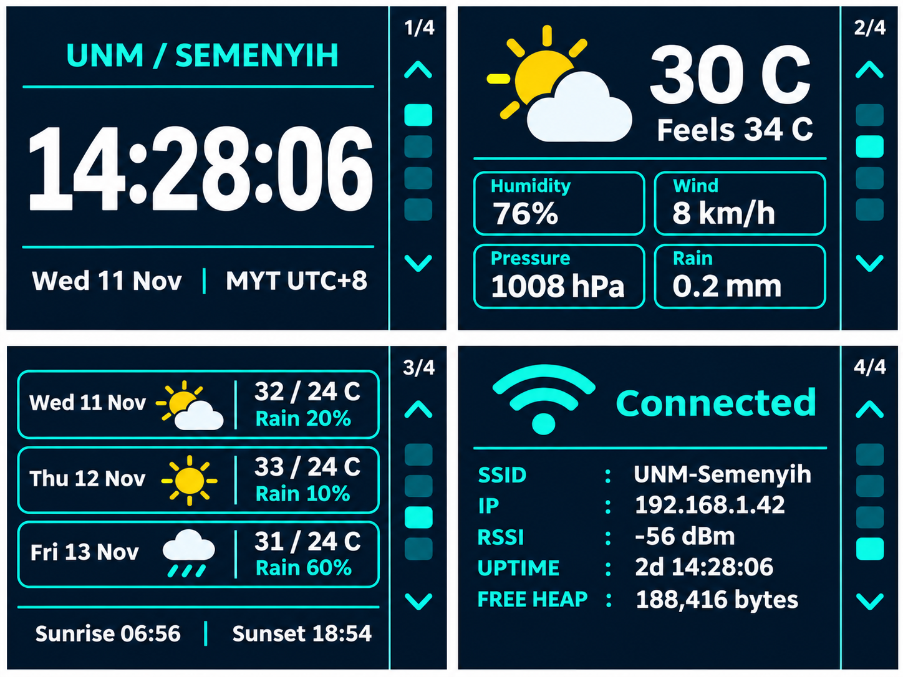

# ESP32 Campus Dashboard

English · [简体中文](README.zh-CN.md)

An ESP32-S3 dashboard with a 2.8-inch ILI9341 SPI display for the University of Nottingham Malaysia campus in Semenyih. It shows the local time, current weather, a three-day forecast, and device status.

This UI mockup uses sample values. The firmware draws the interface with Adafruit GFX.

## Getting started

1. In Arduino IDE 2, install `esp32 by Espressif Systems` from Boards Manager. Select `ESP32S3 Dev Module` and the serial port for your board. Set Flash Size to 16 MB for the N16R8 variant. The prototype was uploaded using Arduino-ESP32 3.3.12.
2. In Library Manager, install Adafruit ILI9341 and its dependencies, plus ArduinoJson 7.
3. Open `CampusDashboard/CampusDashboard.ino` and enter your Wi-Fi network name and password in your local `Config.h`. Restore the placeholders before committing.
4. Compile and upload. See the [development log (Simplified Chinese)](docs/LOGBOOK.md) for wiring and version history.

The upper-right button (GPIO6) moves to the previous page, and the lower-right button (GPIO7) moves to the next page. Navigation wraps in both directions. Earlier versions use GPIO4–7 to open the four pages directly.

Outdoor weather data comes from [Open-Meteo](https://open-meteo.com/en/docs). The clock synchronizes over NTP and displays Malaysia Time (UTC+8). The prototype firmware currently skips HTTPS server certificate verification.
