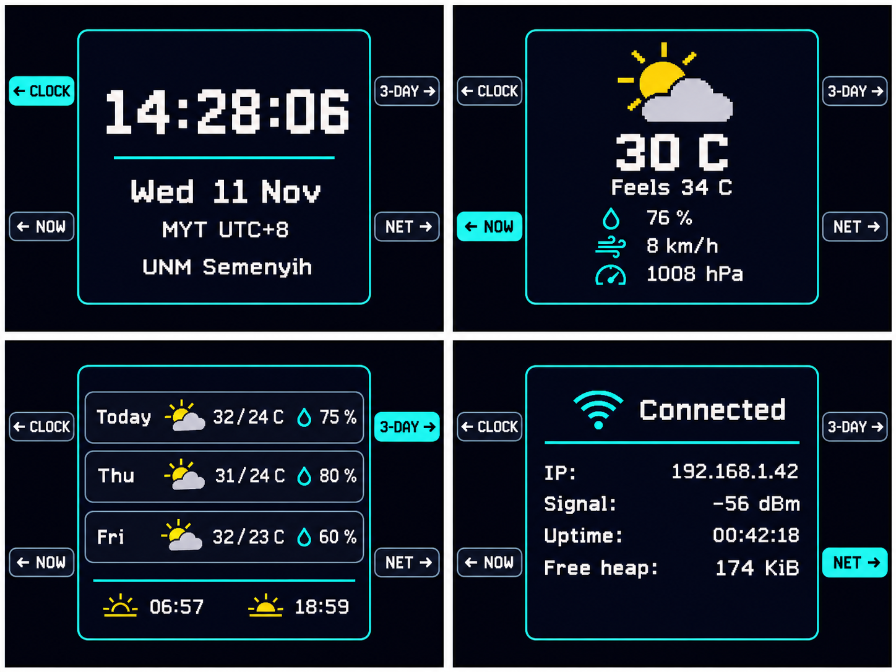

# CampusDashboard 开发日志

## 起点与硬件

项目从 ESP32-S3 N16R8 的 Arduino 串口和烧录测试开始。首次在 Windows 上安装 Espressif 开发板包，随后迁到 macOS。用红、绿、蓝轮流填屏，验证 ILI9341 的供电和 SPI 写入。屏幕原先使用板载稳压器的供电方案，但开发板 USB 供电时在 5Vin 未测到电压，最后焊通屏幕 J1，改用 3.3 V。J1 短接时屏幕 VCC 使用 3.3 V。

| ILI9341 | ESP32-S3 |
|---|---|
| VCC、LED | 3V3 |
| GND | GND |
| CS、RESET、DC | GPIO10、GPIO8、GPIO9 |
| SDI/MOSI、SCK | GPIO11、GPIO12 |

显示测试使用写入模式，屏幕 MISO 和触摸排针留空。照片里的 U2 焊盘未装触摸控制器，早期实验使用 GPIO4 上的杜邦线作为电容触摸电极，后来换成四个实体轻触按钮。按钮接相应 GPIO 和公共 GND，程序启用内部上拉并消抖。

## 联网与模块化

先实现 2.4 GHz Wi-Fi、NTP 校时、日期、IP 和 RSSI。刷新从约每 250 ms 调整为每秒一次，再改为只更新变化的字段。联网天气加入后，将入口、配置、输入、天气和显示拆分为独立模块。天气后台任务每 15 分钟请求数据，失败保留上次结果并重试。默认地点为 University of Nottingham Malaysia，Semenyih（2.945°N，101.874°E），时区为 MYT。室外湿度来自天气模型。

Mac 迁移中通过 Arduino 库管理器补齐 Adafruit ILI9341、依赖和 ArduinoJson 7。一次编译成功后在写主程序时原生 USB 串口断开，经过重新烧录后用户报告运行成功。

## v1.0.0 · 四键直达

- GPIO4、5、6、7 分别打开时钟、当前天气、三天预报和网络页。
- 四角按键提示对应左上、左下、右上、右下，青色高亮当前页。
- 天气图标由 GFX 绘制，预报图标使用各日的天气代码。时钟与网络字段按需刷新。

